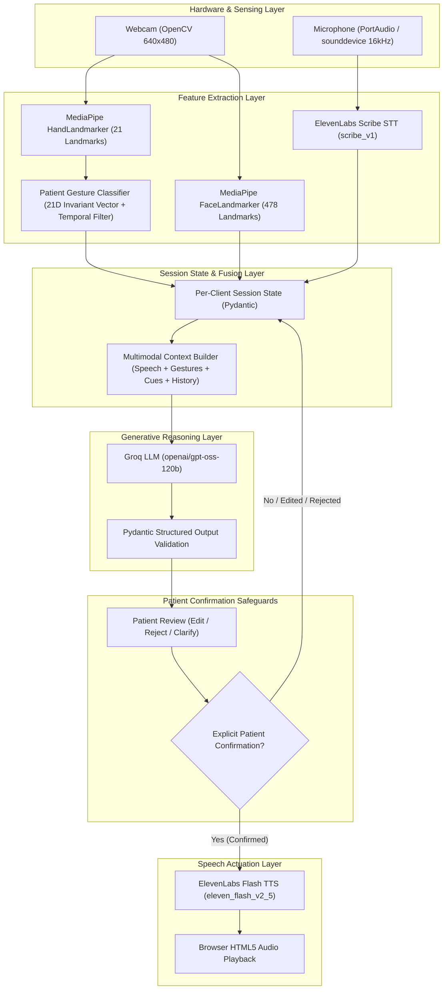
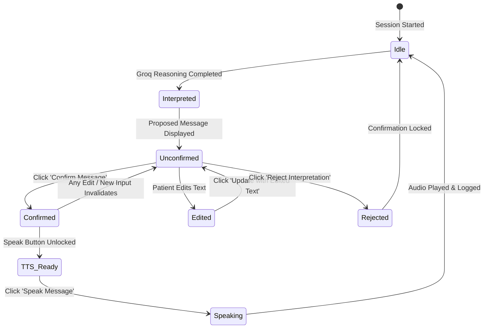
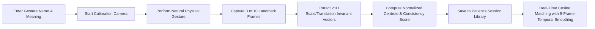

# PS-16: Multimodal Live Conversation Assistant for People with Speech Impairments

A real-time assistive communication platform designed for individuals with speech impairments. The application integrates live camera feeds for physical gesture recognition, microphone audio capture for transcription, and multimodal generative AI to interpret user intent—voiced only upon explicit patient confirmation.

---

## 1. Problem Statement & Proposed Solution

### The Problem
Individuals with dysarthria, ALS, stroke sequelae, cerebral palsy, or other motor/speech impairments struggle to produce speech that conventional speech-to-text models can transcribe reliably. Furthermore:
- Standard speech recognizers frequently fail on dysarthric speech patterns.
- Gestures vary greatly across individuals; universal sign language dictionaries do not fit patient-specific motor limitations.
- Automated speech systems pose dangerous safety risks if they speak on behalf of a patient without prior confirmation.

### The Solution
PS-16 provides an accessible, multimodal conversational bridge:
1. **Multimodal Sensing:** Simultaneously collects speech audio via the Windows default microphone and visual gestures/facial cues via OpenCV and MediaPipe.
2. **Patient-Specific Gesture Calibration:** Patients calibrate their own natural gestures (extracting scale- and translation-invariant normalized geometric vectors) with temporal smoothing, without forcing a predefined sign language.
3. **Multimodal Context Reasoning:** Groq (`openai/gpt-oss-120b`) synthesizes fragmented verbal speech, active calibrated gestures, and dialogue history into a coherent proposed utterance.
4. **Strict Patient Confirmation Safeguard:** Audio synthesis is physically gated behind patient confirmation. Editing, rejecting, or capturing new signals immediately locks the speech engine.
5. **Ultra-Low Latency TTS:** Synthesizes confirmed messages in under 1 second via ElevenLabs Flash TTS (`eleven_flash_v2_5`) using free-tier premade voices.

---

## 2. Key Implemented Features

- **Live Multimodal Vision:** Real-time OpenCV 640x480 frame capture with MediaPipe HandLandmarker (21 landmarks) and FaceLandmarker (478 landmarks).
- **Patient-Specific Gesture Calibration:** In-memory geometric extraction, multi-sample variance estimation, cosine similarity matching, and a 5-frame temporal stabilization window.
- **Ranked Communication Candidates:** Generates 3–4 categorized patient candidate utterances with reasonings and confidence notes, instantly selectable via UI or keyboard shortcuts [1–4].
- **Bidirectional Partner Replies:** Categorizes conversation partner speech and generates instant context-aware reply suggestions (`Yes`, `No`, `Specific`, `Clarification`).
- **Adaptive Patient Profile:** Personalizes intent reasoning with user-defined preferred language, script preferences, common physical needs, and frequent phrases without overriding real-time speech intent.
- **Instant Quick Communication Panel:** Immediate access to non-verbal basic, daily need, and urgent phrases operating independently of STT or cloud LLM inference.
- **Consent-Based Voice Personalization:** Ethical, consent-gated voice customization with account tier validation and instant access to free-tier premade voices (Roger, Sarah, Laura, Charlie, George, Alice).
- **Multimodal Evaluation Framework:** Rigorous benchmark suite measuring WER, intent top-1/top-3 accuracy, and latencies across 60 reference sentences across 4 reasoning modes (`raw_scribe`, `voice_only`, `voice_context`, `full_fusion`).
- **Lip Activity & Syllable Timing (Experimental):** Scale-invariant mouth aperture ratio tracking and articulation cycle peak counting as a timing cue (strictly labeled as a heuristic, not speech recognition).
- **Accessible Alternative Selection:** Standard tap/click fallback, keyboard numbers 1–4, and dwell selection with progress telemetry and instant cancellation.
- **Urgent Caregiver Quick-Help:** Prominent urgent communication pathway with explicit non-dispatch safety notices and instant cancellation.

---

## 3. System Architecture & Workflows

### A. End-to-End System Architecture



### B. Patient Confirmation & Safety Lifecycle



### C. Patient Gesture Calibration Workflow



---

## 4. Technology Stack

| Component | Technology | Rationale |
| :--- | :--- | :--- |
| **User Interface** | Gradio 4.x | Fast, reactive web UI with timer-driven streaming |
| **Computer Vision** | OpenCV 4.8+ & MediaPipe 0.10+ | Real-time hand & face tracking on CPU without GPU overhead |
| **Audio Processing** | SoundDevice & NumPy / SciPy | PortAudio hardware capture in pure 16 kHz mono format |
| **Speech-to-Text** | ElevenLabs Scribe (`scribe_v1`) | High accuracy speech recognition |
| **LLM Reasoning** | Groq API (`openai/gpt-oss-120b`) | ~0.8s - 2.1s ultra-fast structured intent inference |
| **Text-to-Speech** | ElevenLabs Flash TTS (`eleven_flash_v2_5`) | Sub-second audio generation with premade voice compatibility |
| **State Validation** | Pydantic V2 | Type-safe session boundary and strict JSON schema enforcement |

---

## 5. Installation & Environment Setup

### Prerequisites
- Windows 10/11
- Python 3.10, 3.11, or 3.12
- Working webcam and microphone
- Internet connection (for Groq & ElevenLabs APIs)

### 1. Clone & Set Up Virtual Environment
```powershell
cd "d:\PS 16 AI MANTHAN"
python -m venv .venv
.\.venv\Scripts\activate
```

### 2. Install Dependencies
```powershell
pip install -r requirements.txt
```

### 3. Configure API Credentials
Create an `api.env` or `.env` file in the project root:
```env
ELEVENLABS_API_KEY=your_elevenlabs_api_key_here
GROQ_API_KEY=your_groq_api_key_here
ELEVENLABS_VOICE_ID=CwhRBWXzGAHq8TQ4Fs17
```
*(Note: `CwhRBWXzGAHq8TQ4Fs17` is the verified premade Roger voice compatible with free-tier ElevenLabs accounts).*

---

## 6. How to Run the Application

Execute from the project root:
```powershell
.\.venv\Scripts\python.exe main.py
```

Access the UI at:
`http://127.0.0.1:7860`

---

## 7. Step-by-Step User-Centred Demonstration Script

The application is structured into 5 user-centred sections: `🏠 Home`, `⚡ Quick Phrases`, `👤 Personalise`, `🎙️ Voice & Speech`, and `🧠 AI Understanding`.

1. **Instant Communication (`⚡ Quick Phrases`):**
   - Click **Open Quick Phrases ➔** from the Home tab.
   - Click any predefined phrase (e.g., `💧 I need water` or `✅ Yes`).
   - Observe that the phrase appears in the review preview while speech output remains strictly locked.
   - Click **✅ Confirm Phrase** to unlock synthesis, then click **🗣️ Speak Confirmed Phrase** for immediate ElevenLabs Flash TTS playback.
2. **Personalization & Gesture Calibration (`👤 Personalise`):**
   - Set up patient communication preferences (Name, preferred language, script, and routine needs).
   - In **Personal Gesture Training**, click **🎥 Start Camera**, enter gesture name (e.g., `Water Request`) and meaning (`I want water`).
   - Capture 3-5 real landmark samples and click **💾 Save Gesture**.
3. **Speech Recording & Voice Persona (`🎙️ Voice & Speech`):**
   - Click **🎤 Start Recording**, speak a natural utterance (e.g., *"pani chahiye"*), and click **⏹ Stop Recording**.
   - Click **⚡ Transcribe Spoken Audio** to generate verbatim transcription with ElevenLabs Scribe.
   - Choose a verified spoken voice persona (e.g., `Roger`, `Sarah`, `Laura`).
4. **Multimodal AI Reasoning (`🧠 AI Understanding`):**
   - Click **🧠 Analyze Intent with Groq**. Groq combines verbatim speech, patient gesture, and dialogue cues to propose 4 ranked candidate utterances and bidirectional partner replies.
5. **Review & Confirmation Safeguard (`🧠 AI Understanding` - Step 3):**
   - Select candidate `[1]`, `[2]`, or press keyboard key `1`-`4`. Observe speech remains locked until explicit confirmation.
   - Click **✅ Confirm Message** to unlock speech synthesis.
6. **Voice Synthesis (`🧠 AI Understanding` - Step 4):**
   - Click **🗣️ Speak Message (Flash TTS)**. ElevenLabs synthesizes the confirmed phrase in sub-second latency.

---

## 8. Responsible AI, Safety & Privacy Safeguards

- **Strict Explicit Confirmation:** Audio is physically never synthesized without prior patient approval.
- **No Motion-as-Consent:** Head movements (nodding/shaking) are treated strictly as conversational cues, never as legal, medical, or definitive consent.
- **No Universal Sign Assumption:** Gestures are not mapped to arbitrary universal sign dictionaries; only the patient's calibrated gestures are recognized.
- **Language & Script Preservation:** Roman Hindi, English, and Hinglish are kept in their natural spoken Roman script rather than automatically translated into Devanagari.
- **Zero Cloud Video Ingestion:** Raw camera frames never leave the local machine; only lightweight numeric coordinates and landmark vectors are processed locally.

---

## 9. Known Limitations & Future Scope

### Limitations
- **Hardware Concurrency:** Only one physical camera and microphone capture process can hold hardware locks at a time.
- **Single-Hand Calibration:** Current calibrated gesture vectors focus on one hand at a time.
- **Network Dependency:** Speech-to-Text, LLM reasoning, and TTS depend on cloud API connectivity.

### Future Scope
- **Edge LLM Support:** Integration of local quantized small models (e.g., Llama-3-8B / Phi-3 via Ollama) for 100% offline operation.
- **Dual-Hand & Dynamic Gesture Tracking:** Expanding invariant vectors to capture continuous temporal motion trajectories.
- **Eye-Gaze Confirmation:** Implementing dwell-time eye gaze tracking via MediaPipe Iris for patients unable to manually click the Confirm button.
